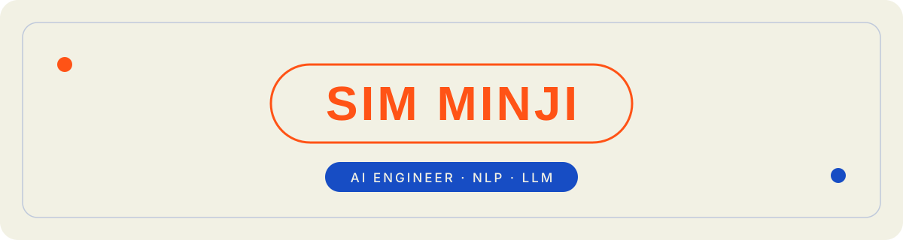

안녕하세요, AI 엔지니어를 준비하는 심민지입니다

**모델이 맞는지보다, 그 결과를 믿어도 되는지와 다음 사람이 이어받을 수 있는지를 먼저 확인합니다.**

 

## About

**텍스트 데이터를 모으는 데서 끝내지 않고, 모델이 실제로 쓰이도록 평가와 배포까지 확인합니다.**

처음에는 문헌정보학을 공부하며 도서관 게시글과 공공데이터를 모아 분석하는 일 자체가 재밌어서 시작했습니다. 그런데 공공기관 연구보고서와 기업 산학협력에서 분석 결과가 실제 의사결정에 쓰이는 것을 보면서, 관심의 중심이 "모델이 잘 맞느냐"에서 "이 결과를 믿어도 되는지, 다음 사람이 이어받을 수 있는지"로 옮겨갔습니다. 그 뒤로는 평가 기준을 먼저 세우고, 배포와 문서까지를 작업 범위에 넣습니다.

- 유튜브 댓글 339만 건 다국어 파이프라인 구축, 골드셋 600건 직접 라벨링으로 감성 모델 선정 (XLM-R macro-F1 0.632)
- 나라장터 공공조달 14,313건 수집 · 토픽 분류 · RFM 세분화 후 Streamlit Cloud 배포와 비개발자 인수인계
- ViT 파인튜닝 기반 딥페이크 탐지 파이프라인을 데이터 구성부터 추론까지 단독 구현
- AI 생성 영상의 의인화 역설을 실증한 제1저자 논문 게재(한국전자거래학회지), 국내외 학회 발표 3회

 

## Education & Certification

- 아주대학교 대학원 비즈니스애널리틱스학과 석사과정 (2025.09 ~ 2027.06 예정)
- 경기대학교 문헌정보학과 학사, GPA 4.07/4.5, 성적장학금 3회
- SQLD 국가공인 SQL 개발자 (2024.04, 영구 자격)

 

## Projects

<b>AI 슬롭 다국어 유튜브 댓글 분석 파이프라인 — 연구 프로젝트, 2026.01 ~ 2026.07</b>

 

AI 생성 영상(슬롭) 채널과 일반 채널의 댓글이 어떻게 다른지 보려고 시작한 프로젝트입니다. 댓글 339만 건을 모아 언어별로 나누고, 감성 모델을 골드셋으로 비교해 골랐습니다. 정제 후 161만 건을 분석했습니다.

수집을 마치고 보니 한국어 비중이 2% 미만이라 준비해 둔 한국어 감정 모델은 쓸 수 없었고, 스페인어 · 포르투갈어 · 영어 · 아랍어가 대부분이었습니다. 그래서 네 언어에서 150건씩 600건을 직접 블라인드 라벨링해 골드셋을 만들고, XLM-R과 mBERT를 같은 기준으로 비교했습니다. 이 과정에서 모델은 데이터를 본 뒤에 고르는 것이고, 비교 기준이 없으면 어떤 점수도 설명할 수 없다는 것을 배웠습니다.

**주요 성과**
- 영상 23,756건 · 쇼츠 16,159건 · 댓글 3,388,659건을 수집하고 정제 후 1,609,406건을 분석했습니다.
- XLM-R이 macro-F1 0.632로 mBERT의 0.448보다 높았고, 언어 간 편차는 0.018에 그쳤습니다.
- 다국어 SBERT + UMAP + KMeans + c-TF-IDF 토픽모델링을 NPMI · TU로 평가하고, 슬롭 채널(K=9)과 일반 채널(K=6)의 토픽 구조 차이를 보였습니다.
- 채널을 하나씩 빼고 다시 돌리는 LOCO로 결과가 특정 채널에 기대지 않는지 확인했습니다.

**핵심 기여**
- YouTube Data API 쿼터 관리와 체크포인트 재개 수집기를 작성했습니다.
- fast-langdetect + langid 언어 식별과 골드셋 600건 라벨링으로 감성 모델을 선정했습니다.
- 임베딩 3종 · 번역 대조 · HDBSCAN을 포함한 토픽 파이프라인을 비교해 최종안을 확정했습니다.
- LLM 다중 모델로 토픽 라벨을 검증하고 RunPod GPU 학습 환경을 운영했습니다.

<b>공공조달 수요 분석 대시보드 — (주)청우씨엔티 × 아주대 산학협력, 2026.07 ~ 2026.08</b>

 

유해가스 정화장비를 만드는 회사가 어느 기관에 무엇을 얼마나 팔 수 있을지 알고 싶어 했습니다. 나라장터 납품요구 14,313건을 수집 · 분석해 Streamlit Cloud에 배포하고, 비개발자가 이어받을 수 있게 인수인계서까지 넘긴 대시보드입니다. [저장소 보기](https://github.com/newspap2r/cwcnt-dashboard)

발표 때마다 돌아온 질문은 모델이 아니라 "이 숫자를 믿어도 되는지"였고, 그 질문에 답하려면 수집 검증과 문서가 분석만큼 필요하다는 것을 겪었습니다.

**주요 성과**
- 2013 ~ 2024 납품요구 14,313건, 기관 5,952곳, 1,290억 원 규모 데이터를 확보했습니다.
- 공개 API로 닿지 않는 구간의 수집 스크립트를 직접 만들고 표본 대조로 일치율 99.4%를 확인했습니다.
- 상위 1,110곳이 매출의 75.7%를 차지한다는 것을 RFM 세분화로 보였습니다.
- Plotly 3탭 앱을 Streamlit Cloud에 배포하고 주간 발표 6회를 거쳐 종합보고서와 인수인계서 v1.0으로 마무리했습니다.

**핵심 기여**
- 납품요구 수집기 작성과 검증을 맡았습니다.
- Kiwi 명사 추출 후 LDA의 K를 10부터 25까지 c_v로 비교해 18로 정하고 13개 그룹으로 묶었으며, BERTopic(ko-sroberta, 63토픽)으로 대조했습니다.
- RFM 세분화와 3D프린터 잠재 고객 분석을 수행했습니다.
- Streamlit + Plotly 앱 개발, 배포, 비개발자용 인수인계서 작성을 담당했습니다.

<b>딥페이크 영상 탐지 — 공모전, 2026.01</b>

 

영상에서 딥페이크를 가려내는 공모전이었습니다. 프레임을 일정 간격으로 뽑아 데이터셋을 만들고 Hugging Face ViT를 파인튜닝한 뒤, 추론 때 좌우 반전을 더하는 Flip TTA로 점수를 끌어올렸습니다. 모델보다 데이터를 어떻게 자르느냐가 결과를 더 크게 바꾼다는 것을 여기서 처음 봤습니다.

**주요 성과**
- 데이터 구성부터 학습, 추론 코드까지 혼자 끝까지 만들었습니다.
- 샘플링 간격과 증강을 바꿔 가며 점수가 어디서 움직이는지 확인했습니다.

**핵심 기여**
- 프레임 샘플링과 데이터셋 구성
- Hugging Face ViT 파인튜닝
- Flip TTA 추론 파이프라인

<b>소상공인 금융정책 체감도 진단 — 소상공인시장진흥공단 연구보고서, 2025 ~ 2026.06</b>

 

전화 상담 STT 235,323건과 커뮤니티 6,510건을 분석해 금융 정책이 현장에서 어떻게 체감되는지 진단한 공단 공식 연구보고서입니다.

**주요 성과**
- LDA · BERTopic 그리드서치로 전체 K=9, 이벤트 구간 K=7을 선정했습니다.
- KR-FinBert-SC 금융 감성분석으로 정책 공지 전후 14 ~ 15일을 비교했습니다.

**핵심 기여**
- STT 상담 텍스트 전처리와 토픽모델링을 맡았습니다.
- 커뮤니티 수집과 감성분석, 전후 비교 분석을 수행했습니다.

<b>소상공인 현장 목소리 주간 발간 — 소상공인시장진흥공단, 2026.06 ~ 현재</b>

 

네이버 카페 · 국민신문고 · 소상공인24에서 약 62,000건을 매주 모으고, 차트 생성부터 HWP · PDF 변환까지 자동화해 주간 브리프를 발간하는 운영 프로젝트입니다.

**주요 성과**
- 29회 이상 주간 발간물을 운영했습니다.
- 수집 → 정제 → 차트 → 문서 변환 → 쪽수 검증까지 자동화해 반복 작업을 줄였습니다.

**핵심 기여**
- 네이버 카페 Selenium/requests 수집기, 국민신문고 · 소상공인24 수집기를 작성했습니다.
- 대시보드 API JSON에서 인포 브리프와 차트를 생성하고 HTML → HWP · PDF 변환을 자동화했습니다.

<b>자동차 사후관리 커뮤니티 분석, 2026</b>

 

보배드림 · 네이버카페 · 빅카인즈 3.2만 건을 크롤링하고 토픽모델 4종을 비교해 가장 설명력 높은 모델을 고른 분석입니다.

**주요 성과**
- LDA · BERTopic · LDA-BERT 등 4종 비교에서 BERT-LDA 하이브리드가 coherence 0.597로 가장 높았습니다.

**핵심 기여**
- Selenium · 내부 API 크롤링과 전처리
- RunPod GPU에서 토픽모델 학습과 비교

<b>Function Calling AI 에이전트 실습 — TypeScript · @agentica/core · OpenAI</b>

 

도구 호출과 스키마 정의로 움직이는 LLM 에이전트를 직접 구현해 본 실습입니다. 모델이 아니라 도구 설계가 결과를 좌우한다는 것을 확인했습니다.

<b>독립서적 추천 시스템 「인디깅」 — 국립중앙도서관 데이터 활용 공모전, 2024</b>

 

독립서적 2,935권을 크롤링하고 수요 설문 74명을 바탕으로 Weighted Jaccard 콘텐츠 기반 추천을 만든 4인 팀 프로젝트입니다.

**핵심 기여**
- 독립서적 메타데이터 크롤링과 추천 로직 구현
- Tableau 시각화

 

## Experience

<b>소상공인시장진흥공단 — 「2026 비정형 데이터 기반 정책현안 분석」 연구참여자, 2026.06 ~ 현재</b>

 

- 주간 수집 · 분석 · HWP/PDF 자동 생성 파이프라인을 운영하고 있습니다.
- 29회 이상 주간 발간물을 발간했습니다.

<b>(주)청우씨엔티 × 아주대 — 산학협력, 2026.07 ~ 2026.08</b>

 

- 공공조달 수요 분석 대시보드를 기획 · 모델링 · 배포 · 이관했습니다.
- 주간 발표 6회, 종합보고서, 비개발자용 인수인계서를 작성했습니다.

<b>아주대학교 — 대학원 조교, 2025.09 ~ 현재 (3학기)</b>

 

- 비즈니스애널리틱스 캡스톤에서 크롤링 수업을 직접 강의했습니다 (이론 45분 + 실습 60분).
- R · Python 실습 과제와 퀴즈를 출제 · 채점하고, R 설치 가이드 PPT와 영상을 제작했습니다.
- 정답 Rmd에서 학생용 Rmd를 생성하는 스크립트 등 교안 제작을 자동화했습니다.

<b>MCE — 현장실습, 2026.01 ~ 2026.02 (8주)</b>

 

- 데이터센터 냉각 기술 영문 뉴스 334건을 수집해 트렌드를 분석했습니다.
- 경쟁사 포지셔닝과 전략 제안을 담은 최종보고서에 참여했습니다.

<b>소상공인시장진흥공단 — 금융정책 체감도 진단 연구참여자, 2025 ~ 2026.06</b>

 

- STT 상담 데이터 NLP 분석을 맡았습니다.

<b>경기대 ICL Lab — 학부연구생, 2024.09 ~</b>

 

- 텍스트 마이닝 · 정보검색 연구를 보조했습니다.

 

## Publications

- 「AI 영상의 의인화 수준과 품질이 시청자 반응에 미치는 영향」 · 심민지 · 강주영 · 한국전자거래학회지 · 제1저자
- 학회 발표 3회 · 한국인터넷전자상거래학회 추계(2025) · 이브릿지 추계(2025) · 홍콩 학술교류 영어 발표(2026.02)

 

## Skills

**ML**

**LLM**

**Data**

**Serving & Tools**

 

## GitHub Stats

 

## Interests

* RAG · 하이브리드 검색과 리랭킹
* LLM 평가와 골드셋 설계
* 다국어 NLP
* 모델 배포 · 서빙과 인수인계
* 데이터 수집 자동화

다음으로 만들 것은 도서 검색 RAG 시스템입니다. bge-m3 + BM25 하이브리드 검색에 리랭커를 붙이고, RAGAS로 평가한 뒤 FastAPI로 서빙하는 것까지를 한 번에 끝내려 합니다. **평가 기준을 먼저 세우고 배포까지 가는 습관**을 LLM 응용에서도 그대로 이어가는 것이 목표입니다.

 

분석에서 끝나지 않고 실제로 쓰이는 것까지 같이 확인할 분을 찾고 있습니다.
mjmj752002@naver.com

